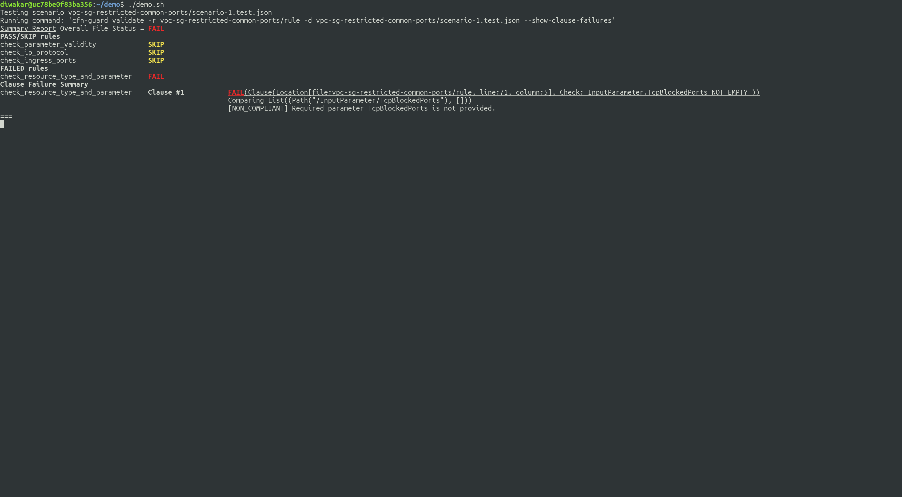
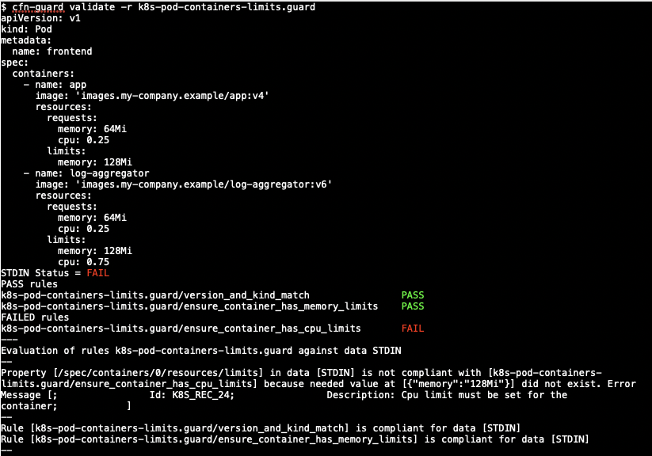
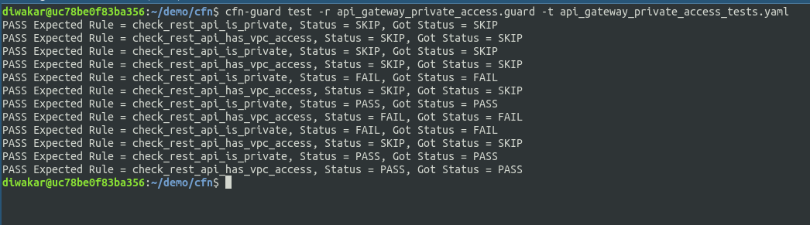
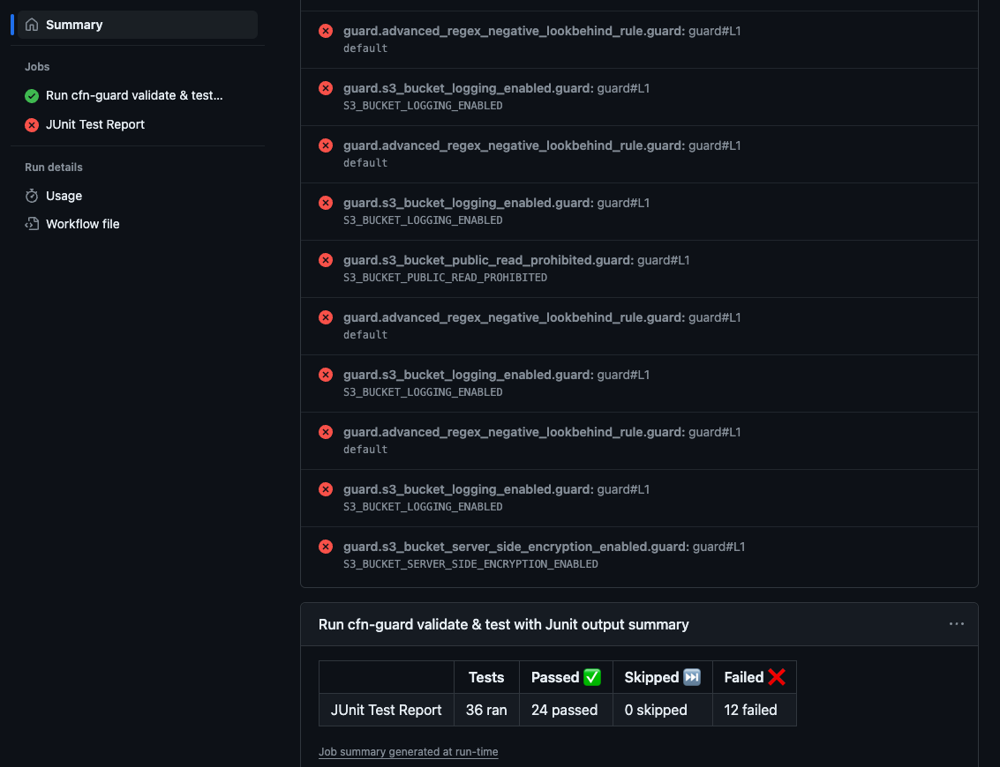
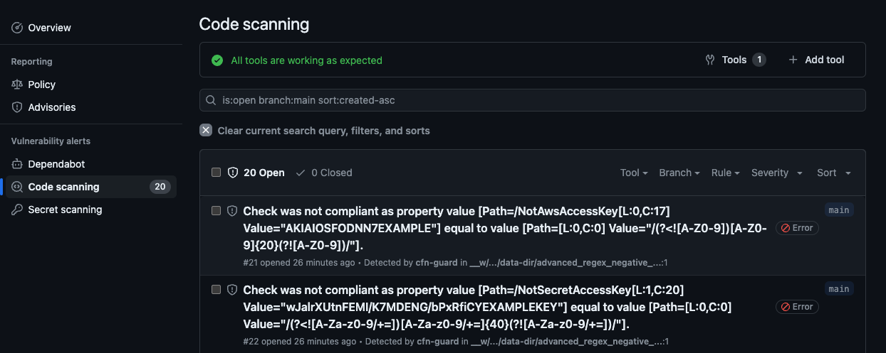
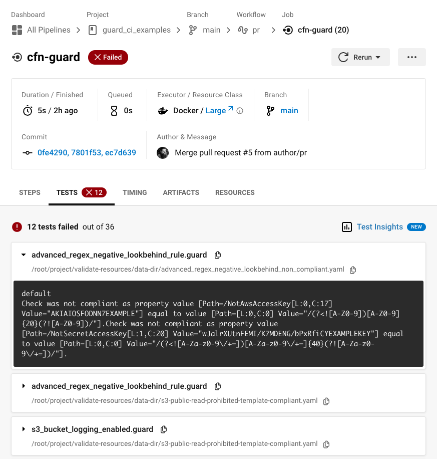

# AWS CloudFormation Guard

**Validate Cloud Environments with Policy-as-Code**

AWS CloudFormation Guard is an open-source general-purpose policy-as-code evaluation tool. It provides developers with a simple-to-use, yet powerful and expressive domain-specific language (DSL) to define policies and enables developers to validate JSON- or YAML- formatted structured data with those policies.

The Guard 3.0 release introduces support for stateful rules through built-in functions, SAM CLI as an alternative deployment method for `cfn-guard-lambda`, command auto-completions for shell, advanced regular expressions, improved handling of intrinsic functions for the test command, as well as the `--structured` flag to the validate command to emit JSON/YAML parseable output. Note that previously written tests may have to be reviewed due to the corrected behavior of intrinsic function handling. Please see the release notes for full details and examples.

Guard can be used for the following domains:

1. **Preventative Governance and Compliance (shift left):** validate Infrastructure-as-code (IaC) or infrastructure/service compositions such as CloudFormation Templates, CloudFormation ChangeSets, Terraform JSON configuration files, Kubernetes configurations, and more against Guard policies representing your organizational best practices for security, compliance, and more. For example, developers can use Guard policies with
   1. Terraform plan (**in JSON format**) for deployment safety assessment checks or Terraform state files to detect live state deviations.
   2. Static assessment of IaC templates to determine network reachability like Amazon Redshift cluster deployed inside a VPC and prevent the provision of such stacks.
2. **Detective Governance and Compliance:** validate conformity of Configuration Management Database (CMDB) resources such as AWS Config-based configuration items (CIs). For example, developers can use Guard policies against AWS Config CIs to continuously monitor state of deployed AWS and non-AWS resources, detect violations from policies, and trigger remediation.
3. **Deployment Safety:** validate CloudFormation ChangeSets to ensure changes are safe before deployment. For example, renaming an Amazon DynamoDB Table will cause a replacement of the Table. With Guard 3.0, you can prevent such changes in your CI/CD pipelines.

> **NOTE**: If you are using Guard 1.0 rules, we highly recommend adopting the latest version of Guard to simplify your current policy-as-code experience. Guard 2.0 and higher versions are backward incompatible with your Guard 1.0 rules and can result in breaking changes. The Guard 2.0 release was a complete re-write of the earlier 1.0 version to make the tool general-purpose.
>
> To migrate from Guard 1.0 rules to use the updated grammar, follow the steps given below.
>
> 1. Pull the release artifacts for the latest `2.x.x` release from the corresponding release page listed [here](https://github.com/aws-cloudformation/cloudformation-guard/releases).
> 2. Use `migrate` command to transition your existing 1.0 rules to use the updated grammar
> 3. Read about all new Guard features from the latest release, and modify your rules for enhanced experience

**Guard In Action**



**Customer Feedback**
Take this [survey](https://amazonmr.au1.qualtrics.com/jfe/form/SV_bpyzpfoYGGuuUl0) to provide feedback about cfn-guard

## Table of Contents

<!-- no toc -->

- [FAQs](#faqs)
- [Guard DSL](#guard-dsl)
  - [Tenets](#tenets)
  - [Features of Guard DSL](#features-of-guard-dsl)
- [Guard CLI](#guard-cli)
  - [Installation](#installation)
  - [How does Guard CLI work?](#how-does-guard-cli-work?)
- [Rule authoring references](#references)
- [Built-in functions & stateful rules](#functions)
- [AWS Rule Registry](#registry)
- [Use Guard as a Docker Image](#docker)
- [Use Guard as a Github Action](https://github.com/aws-cloudformation/cloudformation-guard/tree/main/action#readme)
- [Use Guard as a CI tool](#ci)
- [Use Guard as a pre-commit hook](#pre-commit-hook)
- [Contribute using the DevContainer in VSCode](#devcontainer)
- [License](#license)

## FAQs

**1) What is Guard?**

> Guard is an open-source command line interface (CLI) that provides developers a general purpose domain-specific language (DSL) to express policy-as-code and then validate their JSON- and YAML-formatted data against that code. Guard’s DSL is a simple, powerful, and expressive declarative language to define policies. It is built on the foundation of clauses, which are assertions that evaluate to `true` or `false`. Examples clauses can include simple validations like all Amazon Simple Storage Service (S3) buckets must have versioning enabled, or combined to express complex validations like preventing public network reachability of Amazon Redshift clusters placed in a subnet. Guard has support for looping, queries with filtering, cross query joins, single shot variable assignments, conditional executions, and composable rules. These features help developers to express simple and advanced policies for various domains.

**2) What Guard is not?**

> Guard **is not** a general-purpose programming language. It is a **purpose-built** DSL that is designed for policy definition and evaluation. Both non-technical people and developers can easily pick up Guard. Guard is human-readable and machine enforceable.

**3) Where can I use Guard?**

> You can use Guard to define any type of policy for evaluation. You can apply Guard in the context of multiple domains: a) validating IaC/service compositions such as [CloudFormation Templates](https://aws.amazon.com/cloudformation/resources/templates/), Terraform JSON configuration files, and Kubernetes configurations, b) verifying conformity of CMDB resources such as AWS Config-based CIs, and c) assessing security postures across resources like AWS Security Hub. The policy language and expression is common to all of them, based on simple Guard clauses.

**3) What is a clause in Guard?**

> Clause is an assertion that evaluates to true or false. Clauses can either use binary operations to compare two values (e.g `==, >` and `in`), or unary operations that takes only one value (e.g. `exists, empty,` and `is_list`). Here is a sample clause that compares `Type` to be a `AWS::S3::Bucket` :

```
Type == /AWS::S3::Bucket/
```

**4) What are the supported** **types** **that can I use to define clauses?**

> Guard supports all primitives `string, integer (64), float (64), bool, char, regex` and specialized range expression like `r(10, 200)`, for specifying ranges of values. It supports general key value pair maps (a.k.a associative arrays/struct) like `{ "my-map": { "nested-maps": [ { "key": 10, "value": 20 } ] } },` and arrays of primitives or key-value pair maps like `[10, 20, 30] or [{ Key: "MyApp", Value: "PROD}, ..]`.

**5) What binary and unary comparison operators can I use?**

> _Unary Operators:_ `exists, empty, is_string, is_list, is_struct, is_bool, is_int, is_float, not(!)` > _Binary Operators:_ `==, !=, >, >=, <, <=, IN `
>
> Most operators are self-explanatory. A few important points:
>
> 1. Refer [Guard: Clauses](docs/CLAUSES.md) to understand the usage of `exists` and `empty` operators
> 2. Clause `ports >= [10, 20, 30]` implies that every element for `ports` is `>= 30`. If your intention is range, then express it as `r[10, 30]` .
> 3. Clause `ports >= 100` can have ports resolve to an array `[121, 200, 443]`. This check ensures that every element returned was >= 100, and in the example shown this evaluates to `true.`
> 4. `IN` operator for collections (does not work for `string` type) to check if any value matches. For example:

```
Properties.SslPolicy IN ["ELBSecurityPolicy-TLS-1-2-2017-01", "ELBSecurityPolicy-TLS-1-2-Ext-2018-06"]
```

**6) How can I define advanced policy rules?**

> You can define advanced policy rules using Conjunctive normal form. For example, here is a clause that asserts that all S3 buckets have a) names that start with a common prefix, b) encryption turned on, and c) only KMS-based algorithm is used (to know more about the query part read [Guard: Query and Filtering](docs/QUERY_AND_FILTERING.md)) for IaC template.

```
let s3_buckets = Resources.*[ Type == /S3::Bucket/ ]

# Skip the checks if there are no S3 buckets present
rule s3_bucket_name_encryption_check when %s3_buckets !empty {
    %s3_buckets {
        Properties {
             # common prefix
             BucketName == /^MyCompanyPrefix/

             # encryption MUST BE on
             BucketEncryption.ServerSideEncryptionConfiguration[*] {
                # only KMS
                ServerSideEncryptionByDefault.SSEAlgorithm IN
                    ["aws:KMS"]
             }
        }
    }
}
```

**7) Can I easily test policy rules?**

> Yes. Guard supports a built-in unit testing framework to test policy rules and clauses. This gives customers confidence that their guard policy rules work as intended. You can learn more about this unit testing framework in this doc [Guard: Unit Testing](docs/UNIT_TESTING.md)

**8)** **Does Guard support rule categories?**

> Yes. Guard supports running several rule-sets together for validating policies. You can create multiple rule files, each with its own intended purpose. For example, you can create one rules file for S3, second one for Dynamo DB, third one for access management, and so on. Alternatively, you can create a rules file for all your security related rules, second one for cost compliance, and so on. You can run Guard against all these rule files at once for evaluation. Refer example rules file [Guard: Clauses](docs/CLAUSES.md), [Guard: Complex Composition](docs/COMPLEX_COMPOSITION.md).

**9) Where can I evaluate Guard policies?**

> Guard supports the entire spectrum of end-to-end evaluation of policy checks. The tool supports bringing in shift-left practices as close as running it directly at development time, integrated into code repositories via hooks like GitHub Actions for pull requests, and into CI/CD pipelines such as AWS CodePipeline pipelines and Jenkins (just exec process).

**10) What are you not telling me? This sounds too good to be true.**

> Guard is a DSL and an accompanying CLI tool that allows easy-to-use definitions for declaring and enforcing policies. Today the tool supports local file-based execution of a category of policies. Guard doesn’t support the following things today, along with workarounds for some:
>
> 1. Sourcing of rules from external locations such as GitHub Release and S3 bucket. If you want this feature natively in Guard, please raise an issue or +1 an existing issue.
> 2. Ability to import Guard policy file by reference (local file or GitHub, S3, etc.). It currently only supports a directory on disk of policy files, that it would execute.
> 3. Parameter/Vault resolution for IaC tools such as CloudFormation or Terraform. Before you ask, the answer is NO. We will not add native support in Guard as the engine is general-purpose. If you need CloudFormation resolution support, raise an issue and we might have a solution for you. We do not support HCL natively. We do, however, support Terraform Plan in JSON to run policies against for deployment safety. If you need HCL support, raise an issue as well.
> 4. Ability to reference variables like `%s3_buckets`, inside error messages. Both JSON/Console output for evaluation results contain some of this information for inference. We also do not support using variable references to create dynamic regex expressions. However, we support variable references inside queries for cross join support, like `Resources.%references.Properties.Tags`.
> 5. Capturing what a filter selected under a variable name, as in `Resources[ resource_name | Type == 'AWS::S3::Bucket' ].Properties.Tags not empty`, is supported, and `%resource_name` can be read by later clauses in the same scope. One contract on every path: a capture over a map's entries binds the entries' keys (here the logical ids, also through a wildcard such as `Resources[*][ name | ... ]` and through a variable holding `Resources.*[ ... ]`), and a capture over a list binds the selected elements themselves (`Tags[ t | Key == 'Name' ]` binds the tag, so `%t.Value` reads its value). A map that is one object rather than a collection of entries -- a map one of whose entries is a scalar, such as an IAM `Statement` written as a single statement -- followed by a filter is bound as an element is: `Statement[ s ][ Effect == 'Allow' ]` and `Statement[*][ s | Effect == 'Allow' ]` both bind the statement itself, whether it is written as one object or as a one-element list, so `%s.Action` reads its action either way. A capture name is scoped to the block it is written in and to each resource of a type block. Using a captured value as an interpolated key, `Resources.%name`, requires it to be a string. See [Query and Filtering](docs/QUERY_AND_FILTERING.md#capturing-what-a-filter-selected).
> 6. There are [known issues](docs/KNOWN_ISSUES.md) with potential workarounds that we are tracking towards resolution

**11) What are we really thankful about?**

> Where do we start? Hmm.... we want to thank Rust [language’s forums](https://users.rust-lang.org/), [build management, and amazing ecosystem](https://crates.io/) without which none of this would have been possible. We are not the greatest Rust practitioners, so if we did something that is not idiomatic Rust, please raise a PR.
>
> We want to make a special mention to [nom](https://github.com/Geal/nom) combinator parser framework to write our language parser in. This was an excellent decision that improved readability, testability, and composition. We highly recommend it. There are some rough edges, but it’s just a wonderful, awesome library. Thank you. Apart from that, we are consumers of many crates including [hyper](https://crates.io/crates/hyper) for HTTP handling, [simple logger](https://crates.io/crates/simple_logger), and many more. We also want to thank the open-source community for sharing their feedback with us through GitHub issues/PRs.
>
> And of course AWS for supporting the development and commitment to this project. Now read the docs and take it for a ride and tell us anything and everything.

## Guard DSL

### Tenets

**(Unless you know better ones)**

These tenets help guide the development of the Guard DSL:

- **Simple**: The language must be simple for customers to author policy rules, simple to integrate with an integrated development environment (IDE), readable for human comprehension, and machine enforceable.

- **Unambiguous**: The language must not allow for ambiguous interpretations that make it hard for customers to comprehend the policy evaluation. The tool is targeted for security and compliance related attestations that need the auditor to consistently and unambiguously understand rules and their evaluations.

- **Deterministic**: The language design must allow language implementations to have deterministic, consistent, and isolated evaluations. Results for repeated evaluations for the same context and rules must evaluate to the same result every time. Time to evaluate results inside near-identical environments must be within acceptable tolerance limits.

- **Composable**: The language must support composition to help build higher order functionality such as checks for PCI compliance, by easily combining building blocks together. Composition should not increase the complexity for interpreting outcomes, syntax, or navigation.

### Features of Guard DSL

- **Clauses:** Provides the foundational underpinning for Guard. They are assertions that evaluate to true or false. You can combine clauses using [Conjunctive Normal Form](https://en.wikipedia.org/wiki/Conjunctive_normal_form). You can use them for direct assertions, as part of filters to select values, or for conditional evaluations. To learn more read [Guard: Clauses](docs/CLAUSES.md)

- **Context-Aware Evaluations, `this` binding and Loops:** Automatic binding for context values when traversing hierarchical data with support for implicit looping over collections with an easy-to-use syntax. Collections can arise from accessing an array of elements, values for a map along with a filter, or from a query. To learn more read [Guard: Context-Aware Evaluations, this and Loops](docs/CONTEXTAWARE_EVALUATIONS_AND_LOOPS.md)

- **Query & Filtering:** Queries support simple decimal dotted format syntax to access properties in the hierarchical data. Arrays/Collections are accessed using `[]` . Map or Struct’s values can use `*` for accessing values for all keys. All collections can be further narrowed to target specific instances inside the collection using filtering. To learn more read [Guard: Query and Filtering](docs/QUERY_AND_FILTERING.md)

- **Variables, Projections, and Query Interpolation:** Guard supports single shot assignment to variables using a **`let`** keyword for assignment. All variable assignments resulting from a query is a list (result set). One can also assign static literals to variables. Variables are assessed using a prefix **`%`** and can be used inside the Query for interpolation. To learn more read [Guard: Query, Projection and Interpolation](docs/QUERY_PROJECTION_AND_INTERPOLATION.md)

- **Complex Composition**: As stated earlier, clauses can be expressed in Conjunctive Normal Form. Clauses on separates lines are ANDs. Disjunctions are expressed using the `or|OR` keyword. You can group clauses in a named rule. You can then use named rules in other rules to create more advanced compositions. Furthermore, you can have multiple files containing named rules that together form a category of checks for a specific compliance like “ensure encryption at rest”. To learn more read [Guard: Complex Composition](docs/COMPLEX_COMPOSITION.md)

## Guard CLI

### Installation

#### Installation from Pre-Built Release Binaries

##### MacOS

By default this is built for macOS-12 (Monterey). See [OS Matrix](https://docs.github.com/en/actions/reference/workflow-syntax-for-github-actions#github-hosted-runners)

1. Open terminal of your choice. Default `Cmd+Space`, type `terminal`
2. Cut-n-paste the commands below (default latest, add `-s -- -v <VERSION>` for other versions ie. `-s -- -v 3.1.2`)

```bash
$ curl --proto '=https' --tlsv1.2 -sSf https://raw.githubusercontent.com/aws-cloudformation/cloudformation-guard/main/install-guard.sh | sh
```

Remember to add `~/.guard/bin/` to your `$PATH`.

Alternatively, you can install the latest version with [Homebrew](https://brew.sh/).

```bash
$ brew install cloudformation-guard
```

You would not need to modify `$PATH` this way.

##### Ubuntu

1. Open any terminal of your choice
2. Cut-n-paste the commands below (default latest, add `-s -- -v <VERSION>` for other versions ie. `-s -- -v 3.1.2`)

```bash
$ curl --proto '=https' --tlsv1.2 -sSf https://raw.githubusercontent.com/aws-cloudformation/cloudformation-guard/main/install-guard.sh | sh
```

Remember to add `~/.guard/bin/` to your `$PATH`.

##### Windows

1. Open PowerShell as Administrator
2. Cut-n-paste the command below

```shell
$GuardWindowsInstallScript = Invoke-WebRequest https://raw.githubusercontent.com/aws-cloudformation/cloudformation-guard/main/install-guard.ps1; Invoke-Expression $($GuardWindowsInstallScript.Content)
```

If you get an error regarding authorization to execute the script run the follow before retrying step 2:

```shell
Set-ExecutionPolicy -Scope Process -ExecutionPolicy Bypass
```

#### Installation of Rust and Cargo

##### Ubuntu/MacOS: Install Rust and Cargo

```bash
$ curl --proto '=https' --tlsv1.2 -sSf https://sh.rustup.rs | sh
```

If you have not already, run `source $HOME/.cargo/env` as recommended by the rust installer. Read [here](https://rustup.rs/) for more information.

If building on `Ubuntu`, it is recommended to run `sudo apt-get update; sudo apt install build-essential`.

##### Windows 10: Install Rust and Cargo

1. Create a Windows 10 workspace.
2. Install the version of Microsoft Visual C++ Build Tools 2019 which provides just the Visual C++ build tools: https://visualstudio.microsoft.com/downloads/#build-tools-for-visual-studio-2019.
3. Download the installer and run it.
4. Select the "Individual Components" tab and check "Windows 10 SDK".
5. Select the "Language Packs" tab and make sure that at least "English" is selected.
6. Click "Install".
7. Let it download and reboot if asked.
8. Install [Rust](https://forge.rust-lang.org/infra/other-installation-methods.html#other-ways-to-install-rustup).
9. Download [rust-init.exe](https://static.rust-lang.org/rustup/dist/i686-pc-windows-gnu/rustup-init.exe).
10. Run it and accept the defaults.

#### Cargo-based Installation

Now that you have [rust and cargo installed](https://doc.rust-lang.org/cargo/getting-started/installation.html), installation of cfn-guard is easy:

```bash
$ cargo install cfn-guard
```

Check `help` to see if it is working.

```bash
$ cfn-guard help
cfn-guard 3.1.2

  Guard is a general-purpose tool that provides a simple declarative syntax to define
  policy-as-code as rules to validate against any structured hierarchical data (like JSON/YAML).
  Rules are composed of clauses expressed using Conjunctive Normal Form
  (fancy way of saying it is a logical AND of OR clauses). Guard has deep
  integration with CloudFormation templates for evaluation but is a general tool
  that equally works for any JSON- and YAML- data.

Usage: cfn-guard [COMMAND]

Commands:
  parse-tree   Prints out the parse tree for the rules defined in the file.
  test         Built in unit testing capability to validate a Guard rules file against
               unit tests specified in YAML format to determine each individual rule's success
               or failure testing.

  validate     Evaluates rules against the data files to determine success or failure.
               You can point rules flag to a rules directory and point data flag to a data directory.
               When pointed to a directory it will read all rules in the directory file and evaluate
               them against the data files found in the directory. The command can also point to a
               single file and it would work as well.
               Note - When pointing the command to a directory, the directory may not contain a mix of
               rules and data files. The directory being pointed to must contain only data files,
               or rules files.

  rulegen      Autogenerate rules from an existing JSON- or YAML- formatted data. (Currently works with only CloudFormation templates)
  completions  Generate auto-completions for all the sub-commands in shell.
  help         Print this message or the help of the given subcommand(s)

Options:
  -h, --help     Print help
  -V, --version  Print version

```

### How does Guard CLI work?

The two common Guard CLI commands are `validate` and `test`.

#### Validate

Validate command is used when you need to assess the compliance or security posture as defined by a set of policy files against incoming JSON/YAML data. Common data payloads used are CloudFormation Templates, CloudFormation ChangeSets, Kubernetes Pod policies, Terraform Plan/Configuration in JSON format, and more. Here is an example run of the `validate` command for assessing Kubernetes Pod Container configurations

1. Save the sample policy rules file below as `k8s-pod-containers-limits.guard`:

```
#
# Kubernetes container based limit checks
#

#
# These set of rules primarily apply to the version 1 of the API spec (including v1Beta) and
# the kind of document is a 'Pod'
#
rule version_and_kind_match
{
    apiVersion == /v1/
    kind == 'Pod'
}

#
# For the 'Pod' document ensure that containers have resource limits set
# for memory
#
rule ensure_container_has_memory_limits when version_and_kind_match
{
    spec.containers[*]
    {
       resources.limits
       {
            #
            # Ensure that memory attribute is set
            #
            memory exists
            <<
                Id: K8S_REC_22
                Description: Memory limit must be set for the container
            >>
        }
   }

}

#
# For the 'Pod' document ensure that containers have resource limits set
# for cpu
#
rule ensure_container_has_cpu_limits when version_and_kind_match
{
    spec.containers[*]
    {
       resources.limits
       {
            #
            # Ensure that cpu attribute is set
            #
            cpu exists
            <<
                Id: K8S_REC_24
                Description: Cpu limit must be set for the container
            >>
       }
   }
}
```

2. Paste the command below and hit `enter`

```bash
cfn-guard validate -r k8s-pod-containers-limits.guard
```

3. Cut-n-paste the sample configuration below for k8s pods on STDIN and then hit `CTRL+D`:

```yaml
apiVersion: v1
kind: Pod
metadata:
  name: frontend
spec:
  containers:
    - name: app
      image: "images.my-company.example/app:v4"
      resources:
        requests:
          memory: 64Mi
          cpu: 0.25
        limits:
          memory: 128Mi
    - name: log-aggregator
      image: "images.my-company.example/log-aggregator:v6"
      resources:
        requests:
          memory: 64Mi
          cpu: 0.25
        limits:
          memory: 128Mi
          cpu: 0.75
```



The container `app` does not contain CPU limits specified, which fails the overall evaluation as shown in the screenshot.

#### Input formats

`validate`, `test` and `rulegen`, and the library entry point `run_checks` that guard-ffi and guard-lambda call, read JSON and YAML data with one YAML reader, so a document means the same thing whichever of them reads it. JSON is read as the YAML it is, with these particulars:

* A JSON string that spells a character outside the Basic Multilingual Plane as a surrogate-pair escape (two `\u` escapes, a high surrogate then a low one, which is how Python's `json.dumps` writes 😀 by default) is read as that character. The same escape in a YAML document is refused, because YAML writes that character as `\U0001F600`.
* A raw U+0085 (NEL), U+2028 (LS) or U+2029 (PS) inside a JSON string is read as that character. JSON permits all three unescaped; the YAML reader on its own treats each as a line break and folds it, so `"a<NEL>b"` would have read as `a b`.
* Positions in a report are those of the source text, numbered as the YAML reader numbers lines: CR, LF and CRLF end a line, and so do NEL, LS and PS, even inside a JSON string. Text after one of those three on the same physical line is reported on the next line, which is also how the excerpt beside a finding counts.
* Three more shapes of valid JSON fall outside what the YAML reader's scanner accepts, and are rewritten the way a YAML emitter would write them before the reader sees the text, so the document reads as written: a member name that spans more than 1024 bytes from its opening quote to its colon is read as an explicit key, a line break between a member name and its colon as a space, and a raw U+007F-U+009F character (other than U+0085) or U+FFFE or U+FFFF inside a string as that character. The one shape still refused, with a message that says the document is valid JSON and names it, is a lone surrogate escape (`\uD800` with no low surrogate after it), which is not a character.
* Text that is neither YAML nor JSON (a missing comma between two members, say) is refused with the YAML reader's message and the position where it stopped. When the text begins with `{` or `[` and the JSON reader got at least as far, the JSON reader's own refusal follows on a second line, labeled `Read as JSON as well, the text fails with:`, with its line and column in its own terms (line feeds and bytes, where the YAML reader counts every line break and characters). YAML flow style begins with `{` or `[` too, and a JSON reader stops at its first unquoted key, which is valid YAML and not the mistake, so a JSON position that is earlier than the YAML reader's is not shown; nor is anything from the JSON reader shown for text that begins any other way.
* YAML anchors and aliases resolve on every route, within the budget: a template given to `validate` or `rulegen`, a `test` file, and the data handed to `run_checks`. An alias is a copy of the anchored node, and the copies a document makes are bounded, in nodes and in bytes; a `test` file has that budget per case, with a ceiling over the whole file. The refusals are the same on every route: an alias to an anchor that no earlier node declares, a copy past the budget, a copy that would nest past the reader's depth bound, and an anchor that would take what the document's anchors hold, together, past the budget plus the document's own size (an anchor nested inside another is held once on its own and once inside each anchor around it). See [docs/UNIT_TESTING.md](docs/UNIT_TESTING.md) for the figures.
* An explicit `!!int` tag resolves by the same forms as a plain scalar, so `!!int 0o755` and `!!int 0x1ED` are both the integer 493. The tagged reading used to be decimal only: a document carrying either spelling was refused as a bad value and the run exited 5, while the same document with the tag removed loaded and the rules ran. A tagged decimal with a redundant leading zero is refused when YAML 1.1 and YAML 1.2 read it as different numbers, `!!int 0755` being octal 493 to one and decimal 755 to the other, with a message naming both integers; where the two agree it loads, so `!!int 007` is 7, and as a mapping key `!!int 007:` is the key `7` where it used to be refused.
* A tagged scalar that its `!!` tag cannot read is refused with the node as the document wrote it, tag included: `Value = !!int x` or `Value = !!float x`, where the refusal used to carry the payload alone as `Value = x`. The same text is what the `test` command's json, junit and yaml reports carry for such an input, so a consumer that matched the old string sees the new one.
* `validate` warns on stderr, one line per key, when a key merged in through `<<` collides with a key the mapping already holds in another form (the integer `1` beside the string `"1"`, say): the held value stands, and the line says which of the two is the one evaluated. Such a merged key used to be dropped in silence. The line has the same shape as the one for a key written twice in one mapping, which `test` writes as before for a case's `input`, naming the test file; in every case the verdict and the exit code do not move.
* A merge key reached through an alias (`&m <<:` written once, `*m:` used as a key elsewhere) is the merge key its anchor is: the mapping under it merges into the mapping that carries it, as under a written `<<`, and when it is given anything but a mapping or a sequence of mappings (`*m: abc`) the document is refused as a written `<<: abc` is. Such an alias used to load as an ordinary key named `<<`, with the mapping under it hidden from every rule, so a rule on a key that mapping holds now sees a value it did not, a rule on the key `<<` itself no longer matches, and a document with `*m: abc` that used to load is now refused: `validate` reports it as a parse error naming the file and the position and exits 5, `test` fails the case that holds it, and through `run_checks` the refusal is the parse error a written `<<: abc` already earns (`ParseError`, FFI code 5, naming the file). A C or Lambda caller that branches on that code, or a rule that read the hidden mapping's keys as absent, sees the change. In the same way, an alias of a plain scalar the reader keeps as text (an integer outside the signed 64-bit range, either sign, in any radix, or `.Inf`) is that scalar as a key, so beside its quoted spelling it is the same warned collision wherever the anchor was written; that pair's verdict and exit code do not move, only the warning. Two keys of one mapping that share an anchor's position (`&k x: 1` beside `*k: 2`, or two `*k` keys) are a key written twice and get the duplicate-key warning under `validate` and under `test` for a case's `input`, one line per extra entry; they used to collapse into one entry in silence. The warning names the lines the key was written at, an alias at its own line, and ends by naming the value that stands: "The first value is the one evaluated." or "The last value is the one evaluated." when that value sits at one of the two lines named, and "The value written at L:4,C:3 is the one evaluated." when an alias wrote it at a third line, as for `&k x: 1`, `x: 2`, `*k: 3`, whose warning used to say the first value stood while the alias's `3` did. An alias that writes an anchored key again no longer moves the key behind the entries written between them: `&k x: 1`, `y: 2`, `*k: 3` keeps the keys in the order `x, y`, as the plain `x: 1`, `y: 2`, `x: 3` does, so a capture over the map and a `.*` enumeration read the entries in the author's order; the key moves only when a plain spelling of the name sits after it, where the value written last has to stand. The value written last stands, whichever spelling wrote it: for the pair alone that is what stood before, so the verdict does not move; where a plain spelling of the name sat between an anchored key and its alias (`&k x: 1`, `x: 2`, `*k: 3`), the plain spelling's value used to stand, and the last one written does now.
* `json_parse` refuses an embedded string whose member names differ as written but read as one key, such as `{1: "a", "1": "b"}`, and the clause that called it fails closed, with a message that names the property and the key. Every key becomes text on the way into the value model, so the second member used to replace the first and nothing said so.
* Through `run_checks`: data that holds no document (empty, or only comments) evaluates as a null document, as it did before; a key written twice keeps its last value, as under `validate`, and silently, since this entry point has no terminal for `validate`'s warning; and a document the reader cannot parse is reported as a parse error (`ParseError`, FFI code 5, with the file's name and the reader's message under one prefix) where it was a YAML error (`YamlError`, FFI code 2) before the two readers were made one. A C or Lambda caller that branches on that code sees the change.
* A warning on stderr from `validate`, `test` or `rulegen` is one printable line, whatever it quotes: a control character, a bidirectional control or a zero-width character in a key, a YAML tag, a test case's name, a file name or a quoted key in a rules file is written as its Rust escape (`\n`, `\u{1b}`, `\u{202e}`), so a key holding an ESC can no longer open a terminal escape sequence from the stream and one holding a bidi override can no longer reverse the rest of the line; a backslash in a key or a tag is written as `\\`, so two names that would print alike print apart; and a backslash in a file name, in the position a deprecation notice names, and in the path and reason a gate notice names an entry by is kept as written, so a Windows path reads in a warning as it reads on stdout and in the report, and one entry is spelled one way on one line. Text that compares a warning's quoted names or paths byte for byte sees the change for a name that holds any of these.
* For code that uses cfn-guard as a library: the `test` command's parsed case, `TestSpec` (`cfn_guard::commands::test::TestSpec`), is built by the command from the spec file and no longer derives `Serialize` or `Deserialize`; its `input` is the YAML reader's own value rather than a serde value, and it cannot be named or constructed outside the crate.
* For code that uses cfn-guard as a library: `cfn_guard::Error` gains the variant `Unevaluatable(String)`, a clause that has no answer on the data it was given, and `cfn_guard::InternalError`, the payload of `Error::InternalError`, gains `EventRecordMismatch(String)`, a defect in the evaluator's own bookkeeping, and `UncheckedParserInvariant(String)`, an invariant the parser keeps that reached evaluation unchecked (a parameterized call with the wrong number of arguments, a binary clause with no right-hand side; reachable only from a rules file assembled without the parser), each of which stops the run. Neither enum is marked `#[non_exhaustive]`, so a `match` outside the crate that names every variant stops compiling until it has an arm for each new one, or a wildcard arm.
* For code that uses cfn-guard as a library: `cfn_guard::Error` also gains `MissingDocument`, data that parsed and held no document; `UndecidableComparison(String)`, a comparison the engine abandoned part way, such as a regular expression that ran out of backtracking budget; and `UnsupportedDocument(String)`, a document that parsed and holds a construct cfn-guard does not model, which is also how valid JSON that the YAML reader refuses is reported. An exhaustive `match` on `Error` needs an arm for each of these too.
* For code that uses cfn-guard as a library: `parse_template_and_call_gen` (`cfn_guard::commands::rulegen::parse_template_and_call_gen`) returns `Result<RuleMap, cfn_guard::Error>`, where `RuleMap` (`cfn_guard::commands::rulegen::RuleMap`) names the resource type to property name to values map the function has always built; a template it cannot read comes back as a parse error, where the function used to write the message to stderr and exit the process. A caller that used the returned map directly now unwraps or propagates it.
* For code that uses cfn-guard as a library: the constant `INPUT_PARAMETERS` (`cfn_guard::commands::INPUT_PARAMETERS`) reads `("input-params", 'i')`, the flag `validate` has accepted all along, where it used to read `("input-parameters", 'i')`; a command line built from the constant now names the flag the parser recognizes, and the old spelling, `input-parameters`, is accepted as a hidden alias of `--input-params`, so a command line built from the old value still parses.
* For code that uses cfn-guard as a library: `TestExpectations` (`cfn_guard::commands::test::TestExpectations`) and `ValidateBuilder` (`cfn_guard::ValidateBuilder`) implement `Default`; both are additions, and nothing that compiled against them stops compiling.
* For code that calls cfn-guard through its WebAssembly entry point (`tryBuildAndExecute`, which rejects with a JavaScript `Error` whose message is the run's diagnostic): for a run that evaluated no rules file, or no data file, the message now opens with the warning that nothing was checked, and the lines naming the files the directory walk passed over follow it, at most twenty named and the rest counted; it used to open with the file names and end with the warning. A caller that matched on the message's first line sees the warning where it saw a file name. The command line's own stderr is unchanged and keeps the names first.
* For code that uses cfn-guard as a library: `Writer` (`cfn_guard::utils::writer::Writer`) gains no method that returns both of a run's streams at once. Code that needs stdout and stderr from one run writes each to a `WriteBuffer::File` and reads each file back through a `Writer` of its own, with `stripped` and `err_to_stripped`.
* A variable bound to another variable that names a top-level key, `let all = Resources` then `let r = %all`, is read as that key wherever `%r` is used: a filter or `.*` over it on a template with no such key, or an empty one, is an empty selection and the clause is not applicable, as it is for `let r = Resources` and for the key written out. `%r.*[ Type == 'AWS::S3::Bucket' ].Properties.BucketName == 'b'` over `{}` or `{"Resources": {}}` used to fail at exit 19 through the alias while the direct spelling passed at exit 0 with nothing to check; both now exit 0, and so does a parameterized rule passed `%r`. A `!exists` or `empty` assertion over the same selection through the alias used to pass and is now not applicable. See [CLAUSES.md](docs/CLAUSES.md#filtering-through-a-variable).
* A filter written directly after a variable bound to a list below the top level, `let cs = spec.template.spec.containers` then `%cs[ name == 'app' ] exists`, over `containers: []` is not applicable, exit 0, as the literal `spec.template.spec.containers[ name == 'app' ] exists` is; through the variable it used to read the empty list as the authored `containers[*][ name == 'app' ] exists` does and fail at exit 19, and the authored spelling keeps that failure. The negated filter and a `when` gate over it move with it: `%cs[ name == 'app' ] !exists` used to pass over the empty list and a negated gate used to open its block; both are not applicable now, as the literal spellings are. A rule that demands a matching container therefore lets a pod with `containers: []` through at exit 0 when written through the variable, as it always did when written as the literal filter; write `%cs[*][ name == 'app' ] exists` to keep the failure on the empty list. The same holds through a let-chain, a parameterized rule's parameter and a list one level down. See [CLAUSES.md](docs/CLAUSES.md#filtering-through-a-variable).
* A key filter's function argument read from the scope beside the map (`Resources.Cfg.Map[ keys == to_lower(Wanted[ Use == true ].Name) ]` over a document whose `Wanted` sits at the top level, not in the map) is read as a value beside the map, so a bare `Wanted:` there (null) under the filter is the absent key's unresolved read and the clause fails closed at exit 19, naming `/Wanted`, as it does when the map's own `Wanted:` is bare; it used to read the top-level null as the document's empty population and report the rule not applicable at exit 0, with the root-read notice, where the same null in the map failed. The notice is still printed for the read from the top level. `Wanted: []` and an absent `Wanted` keep their readings (the empty set, not applicable; the in-map miss, failing closed). The same holds when the argument's first key names the document's own population: `Mappings.Allowed[ keys IN to_lower(Resources.*[ Type == 'AWS::S3::Bucket' ].Properties.BucketName) ]` at the file's root over a bare `Resources:` fails closed at exit 19 (it used to read the null as the empty population and report the rule not applicable at exit 0 under `IN`, passing under `NOT IN`), while over `Resources: {}` it stays the empty set and the plain clause `Resources.*[ ... ].Properties.BucketName empty` keeps its population reading over both. See [CLAUSES.md](docs/CLAUSES.md) and [FUNCTIONS.md](docs/FUNCTIONS.md).
* A parameterized rule whose `when` condition declares a filter capture under one of its own parameter names, `rule check(p) when Resources[ p | Type exists ] !empty { %p[ Statement exists ] !empty }`, is refused when the rules file is loaded, with a message naming the parameter and the rule, and `validate` exits 5 as it does for any rules file it cannot parse; every `%p` in the rule read the parameter, so the capture could never be read, and the file used to load and evaluate with the capture doing nothing. See [CLAUSES.md](docs/CLAUSES.md#filtering-through-a-variable).
* A filter straight after `.*` over a map holding a bare key beside its members, `Resources.*[ Type == 'AWS::S3::Bucket' ].Properties.BucketName exists` over a `Resources` whose `B:` has no body, hands the null entry to the predicate, which fails on it and drops it, so the members beside it decide the clause and it passes at exit 0; in the released 3.1.12, 3.2.0 and 3.2.1 binaries, built from the release commits and measured, it failed: the rule reads `FAIL`, and the released CloudFormation reporter then panics at exit 101 (`internal error: entered unreachable code`) in place of a failure text; the retrieval error `Filter on value type that was not a struct or array null /Resources/1` was read on 3.2.1's type-block line over the list twin of this template. The cells, this spelling's and the absence check's, are tabled under the one-object `[*]` rule in [docs/CLAUSES.md](docs/CLAUSES.md#one-object-wildcard).
* A filter straight after `[*]` over a map of members, `Resources[*][ Type == 'AWS::S3::Bucket' ]` over a `Resources` map, enumerates the resources and selects the buckets, as `.*` and the literal `Resources[ ... ]` do; the released 3.1.12, 3.2.0 and 3.2.1 binaries, built from the release commits and measured, asked the filter's predicate of the document that holds the `Resources` map, which has no `Type`, so they selected nothing and `Resources[*][ Type == 'AWS::S3::Bucket' ].Properties.BucketName exists` was not applicable at exit 0 with a bucket unflagged (`Resources[*][ Type == 'AWS::S3::Bucket' ] empty` passed and `!empty` failed). The cells are tabled under the one-object `[*]` rule in [docs/CLAUSES.md](docs/CLAUSES.md#one-object-wildcard).
* A filter straight after `[*]` over a list, `Resources.*.Properties.Tags[*][ Key == 'Env' ].Value == 'prod'` over list-shaped tags or `Resources.*.Properties.PolicyDocument.Statement[*][ Effect == 'Allow' Action == '*' ] empty` over a one-element `Statement` list, enumerates the list's elements and evaluates the clause over them. The cells are tabled under the one-object `[*]` rule in [docs/CLAUSES.md](docs/CLAUSES.md#one-object-wildcard).
* A filter straight after `.*` over a list, `Resources.*[ Type == 'AWS::S3::Bucket' ] !empty` or `Resources.*[ Type == 'AWS::S3::Bucket' ].Properties.BucketName exists` over a `Resources` written as a list of buckets, and `Resources.*.Properties.PolicyDocument.Statement.*[ Effect == 'Allow' Action == '*' ] empty` over a one-element `Statement` list, enumerates the list's elements as `.*` over a map enumerates its entries. The cells are tabled under the one-object `[*]` rule in [docs/CLAUSES.md](docs/CLAUSES.md#one-object-wildcard).
* The reason a report carries for a key filter (`[ keys == ... ]`) that met a value with no entries to select among reads `Map Filter for keys was not a struct <type> <path>` whichever part sat before the filter, the key itself, `.*` or `[*]`; after a wildcard it used to read `Filter on value type that was not a struct or array <type> <path>`, the wording for a filter over properties. A consumer that matched the old string for a key filter after a wildcard sees the new one. Two verdicts move with the same change: `%r.B.Properties.Tags[ Key == 'Env' ] exists` with `let r = Resources` over a template with no `Resources` key was not applicable and now fails at exit 19 on the key `B`, as the spelling without the alias does; and `X[*].K[ ... ] exists`, a wildcard then a key then a filter, over a bare top-level `X:` (null in YAML) or over `X: {}`, used to fail on the key and is now not applicable, as it is over `{}` and over `X: []`. The other polarity moves with it: `X[*].K[ ... ] !exists` over the same two used to pass, reading the key as absent, and is now not applicable, so a `when` gate written on it that used to open its block leaves it unopened and the assertions in the block are not run; and the block spelling `X { this[*].K[ ... ] exists }` moves as the plain one does, from failing on the key to not applicable.
* A key filter whose right-hand side is itself refused on the data, `Resources.*.Properties.M[ keys == Tags[ Key == 'Env' ].Value ]` or `[ keys == to_upper(Tags[ Key == 'Env' ].Value) ]` over a resource whose `Tags` holds a string, is answered for that map as a key filter whose right-hand side the document lacks is: the map is recorded as undecidable with the refusal as its reason, and the clause reads it as it reads every undecidable map. A rule over the one refused map fails closed in either polarity, as it did when the refusal was an error, and the failure is now recorded at the map; under `some` over several maps a sibling whose own selection passes settles the clause, so `some Resources.*.Properties.M[ keys == to_upper(Tags[ Key == 'Env' ].Value) ] !empty` passes over a list-tagged resource beside the string-tagged one where it used to fail at exit 19 with the line "Clause could not be evaluated against the incoming context ... when handling clause, bailing"; and a `when` gate over several maps whose operator is a comparison is settled by a sibling, so `when Resources.*.Properties.M[ keys == Tags[ Key == 'Env' ].Value ] == 1 { ... }` reads not applicable at exit 0 when another resource's selected value is a decided failure, and `when some Resources.*.Properties.M[ keys == to_upper(Tags[ Key == 'Env' ].Value) ] == 1 { ... }` opens its block when another resource's selected value passes, where both used to fail the rule closed; a gate whose operator is `exists`, `!exists`, `empty` or `!empty` fails the rule closed on the undecidable map whatever the siblings say, as it did. A capture on the filter (`[ n | keys == ... ]`) holds the marker, so `%n exists` fails closed with the reason where it used to read an empty binding.
* A filter over a section's entries, under every spelling (`Resources[ Properties.Tags !exists ] empty`, the same through `let r = Resources` and `%r[ ... ]`, after `[*]`, after `.*`, and the block's `this[ ... ]`), passes an entry under an intrinsic directive key over when the predicate is about the members, by the entry's own key and position and never by the kind of what sits beside it: any `Fn::` key at a template section (`Fn::Transform`, an `AWS::Include`, beside the resources or alone; a map-valued `Fn::ImportValue` written where a member would be), and `Fn::ForEach::<Name>` (an `AWS::LanguageExtensions` loop) at any depth, alone or beside members, since a loop writes keys into the map that holds it and its expansion, not the loop, is the members. The section rule, the `Parameters` exception and the cells are under [item 15 of docs/KNOWN_ISSUES.md](docs/KNOWN_ISSUES.md#filter-after-a-wildcard-over-a-map-holding-the-key).
* A query a report renders with the parser's own name for a filter (a `Check =` or `Context=` line, a remaining query, an empty-selection reason) joins an unnamed filter without a `.`: `Resources.* (filter-clauses)`, `Resources (map-key-filter-clauses).Type`, `Resources.B.Properties.Tags (filter-clauses)`, where the same texts used to read `Resources.*. (filter-clauses)`, `Resources. (map-key-filter-clauses).Type` and `Resources.B.Properties.Tags. (filter-clauses)` with a stray `. `. A named filter keeps its `.` (`Tags.p (filter-clauses)`), a quoted key keeps its `.` whatever its text (`M.[x` for the key `"[x"`, where it used to render `M[x`), and a numbered index keeps its `.` as before (`Tags.0.Key`).
* A key filter over a map with a scalar entry whose predicate can hold by absence is refused only where reading the map as one object disagrees with the walk over its entries, and that reading now reads the predicate as `X[*][ ... ]` reads it: a function argument the map lacks is read from the scope beside the map, so `Cfg[ Owner !exists  this[ keys == to_upper(Env) ] !empty ] empty` over `Cfg: { Mode: fast, PROD: 1 }` with `Env: prod` at the document root is refused at exit 19 with the `X[*][ ... ]` remedy (it passed at exit 0, the readings disagreeing unseen) and passes at exit 0 over `Env: dev`, as `Cfg[*][ ... ] empty` passes there; an error the reading meets is the filter's own, so `Cfg[ Owner !exists  this[ Owner !exists ] !empty ] empty` over that map fails at exit 19 with the nested refusal the `[*]` spelling raises (it passed at exit 0), while a failing conjunct beside the refused clause (`Kind == 'k'` over a map without `Kind`) still passes `empty` under both spellings, and a rules-file mistake inside the predicate (`parse_int('abc')`) exits 5 under both where the key spelling used to pass at exit 0 beside such a conjunct. See [docs/CLAUSES.md](docs/CLAUSES.md#filtering-through-a-variable); the cells are tabled under [item 15 of docs/KNOWN_ISSUES.md](docs/KNOWN_ISSUES.md#filter-after-a-wildcard-over-a-map-holding-the-key).
* A filter straight after `.*` over a map holding a scalar entry, under a predicate that holds on the map itself by the absence of a key, reads the members and is not refused for the scalar: `spec.*[ securityContext !exists ] !empty` over a `spec` whose `replicas: 3` sits beside two sub-maps lacking the key keeps the sub-maps and passes, and over a `spec` of nothing but scalars selects nothing, so `empty` passes, `!empty` fails and a `when` gate on the selection stays closed, where the released 3.1.12, 3.2.0 and 3.2.1 binaries, built from the release commits and measured, failed on the scalar with a retrieval error in both shapes. The cells, the literal `spec[ securityContext !exists ]` among them, are tabled under [item 15 of docs/KNOWN_ISSUES.md](docs/KNOWN_ISSUES.md#filter-after-a-wildcard-over-a-map-holding-the-key).
* A comparison whose right-hand side holds an undecidable marker (a refused `%name`'s, or the one a key filter leaves for a map whose keys it could not read) beside resolved values or absent operands is read pair by pair, and only a clause nothing else decides fails closed on the marker: `when Y IN <selection with a marker>` with `Y` equal to a resolved value runs its body where it failed, and the assertion `Y IN <selection with a marker>` passes the same way (a refused read beside the listed value is reported on stderr rather than raised, with no record of it in the structured reports, since the clause passed; a non-failing record there is a later change; where a reference the document lacks beside the same listed value still fails the membership: the two readings stand as released); `some X NOT IN %x` and `some X != %x` beside a marker of either kind fail where they passed; `when L[*] == <selection with a marker>` with a left-only mismatch fails closed where it was not applicable; and an absent operand beside a marker of either kind (a value the document lacks, an empty collection, a right-hand reference that resolved to nothing) is a decided failure for that value, so a `when` condition is not applicable and a filter predicate deselects the entry where both failed their rule closed, with a refused read beside such a decision reported in the record and on stderr rather than raised (a right-hand reference the document lacks under a positive `IN` beside a marker is a decided no for its own pair alone: membership is `OR` over the pairs, so `when Owner IN %names` with such a reference and a marker among the values, `Owner` equal to no listed value, is raised on the marker's reason, as released; and under `some` a right-hand reference that resolved to nothing beside a marker, with no resolved value beside them, is raised in both polarities rather than decided, since the marker's pair may be the one the value passes against, where the `match_all` spelling is decided by the absence); a refused read beside a value that does NOT match (`[ Properties.Owner == %names ]` over an `Owner` no listed pair equals, `when Cfg.Mode == %x` with a resolved mismatch, `when some Names[*] NOT IN %x` with every name colliding) lets the resolved no decide (the released 3.1.12, 3.2.0 and 3.2.1 binaries, built from the release commits and measured, read the two `when` conditions not applicable at exit 0 and reported the refused read nowhere, and stopped on the filter predicate with an internal error, `entered unreachable code`, before any verdict), so the predicate deselects the entry and the condition is not applicable, and that refused read, like one beside a `some` that passed on another of its values, is reported on stderr the same way, once per clause site, the line naming the clause as written, how it was decided (with the count of evaluations each way when it was decided more than one way), the distinct refusals (numbered when there are several), and ending with the clause's position and the input it was found in (the data file under `validate`, the case and its spec file under `test`); the refused read beside an absence is also in the absent value's own record, after the retrieval's own reason, printed whole by the console, as is the refused read beside a value no listed entry accepted under a positive `IN`; and an assertion raised on a refusal's reason (`some X NOT IN %x` beside the marker, `X IN %x` against the marker alone) is recorded as the refusal it is, printed whole by the console where every other recorded message is held to 320 characters, with the record sentence `Error <reason> when handling clause; the clause is raised and the run continues` where it read `..., bailing` over a run that went on. The moves and the tests that pin them are listed under the behavior-change entry for this comparison in [docs/CLAUSES.md](docs/CLAUSES.md#notices) (the entry just before "How `validate` writes notices").
* The `messages.error_message` of a record that carries a refusal (a comparison decided beside a refused read, a right-hand value the evaluator refused to read, a unary check refused over a value) quotes each value it takes from the template, the value a query traversed to and the two values a comparison decided, escaped and cut at 256 printed characters with a marker, `...[N more characters cut]`, where it used to quote the value whole; a right-hand value the evaluator refused to read keeps the sentence `the value to compare to could not be read` followed by the refusal, chosen by the operand's own kind rather than by the record's flag, and an absent right-hand value keeps the missing-property sentence naming the key, beside a refused read among the other values too; the record of a refused left-hand marker compared against a right-hand side the document lacks leads with the right-hand retrieval's own reason, the missing key named, and carries the refusal after it, printed whole by the console, where it carried the refusal alone with no key named. A consumer of `-o json` or the other structured outputs that matched the old string, or read a value out of the sentence, reads the structured `check` field, which still carries every value whole. A record that is no refusal keeps its sentence as released. A unary check refused over a value the document lacks is now recorded as the refusal it is, so the console prints its sentence whole, the remedy included, on an `Error =` line where it printed nothing of it.

#### Using Input Parameters

Guard allows you to use input parameters for dynamic data lookups during validation. This feature is particularly useful when you need to reference external data in your rules. However, when specifying input parameter keys, Guard requires that there are no conflicting paths.

##### How to use

1. Use the `--input-params` or `-i` flag to specify files containing input parameters. Multiple input parameter files can be specified and will be combined to form a common context. Input parameter keys can not have conflicting paths.
2. Use the `--data` or `-d` flag to specify the actual template file to be validated.

##### Example Usage

1. Create an input parameter file (e.g., `network.yaml`):

```yaml
NETWORK:
  allowed_security_groups: ["sg-282850", "sg-292040"]
  allowed_prefix_lists: ["pl-63a5400a", "pl-02cd2c6b"]
```

2. Reference these parameters in your guard rule file (e.g., `security_groups.guard`):

```
let groups = Resources.*[ Type == 'AWS::EC2::SecurityGroup' ]

let permitted_sgs = NETWORK.allowed_security_groups
let permitted_pls = NETWORK.allowed_prefix_lists
rule check_permitted_security_groups_or_prefix_lists(groups) {
    %groups {
        this in %permitted_sgs or
        this in %permitted_pls
    }
}

rule CHECK_PERMITTED_GROUPS when %groups !empty {
    check_permitted_security_groups_or_prefix_lists(
       %groups.Properties.GroupName
    )
}
```

3. Create a failing data template (e.g., `security_groups_fail.yaml`):

```yaml
# ---
# AWSTemplateFormatVersion: 2010-09-09
# Description: CloudFormation - EC2 Security Group

Resources:
  mySecurityGroup:
    Type: "AWS::EC2::SecurityGroup"
    Properties:
      GroupName: "wrong"
```

4. Run the validate command:

```
cfn-guard validate -r security_groups.guard -i network.yaml -d security_groups_fail.yaml
```

In this command:

- `-r` specifies the rule file
- `-i` specifies the input parameter file
- `-d` specifies the data file (template) to be validated

##### Multiple Input Parameters

You can specify multiple input parameter files:

```
cfn-guard validate -r rules.guard -i params1.yaml -i params2.yaml -d template.yaml
```

All files specified with `-i` will be combined to form a single context for parameter lookup.

#### Test

Test command is used during the development of guard policy rules files. Test provides a simple integrated unit-test frameworks that allows authors to individually test each policy file for different types of inputs. Unit testing helps authors gain confidence that the rule does indeed conform to expectations. It can also be used as regression tests for rules. Here is example run for `test` command

1. Save the sample policy rules file below as `api_gateway_private_access.guard`:

```
#
# Select from Resources section of the template all ApiGateway resources
# present in the template.
#
let api_gws = Resources.*[ Type == 'AWS::ApiGateway::RestApi' ]

#
# Rule intent
# a) All ApiGateway instances deployed must be private
# b) All ApiGateway instances must have atleast one IAM policy condition key to allow access from a VPC
#
# Expectations:
# 1) SKIP when there are not API Gateway instances in the template
# 2) PASS when ALL ApiGateway instances MUST be "PRIVATE" and
#              ALL ApiGateway instances MUST have one IAM Condition key with aws:sourceVpc or aws:SourceVpc
# 3) FAIL otherwise
#
#

rule check_rest_api_is_private when %api_gws !empty {
  %api_gws {
    Properties.EndpointConfiguration.Types[*] == "PRIVATE"
  }
}

rule check_rest_api_has_vpc_access when check_rest_api_is_private {
  %api_gws {
    Properties {
      #
      # ALL ApiGateways must have atleast one IAM statement that has Condition keys with
      #     aws:sourceVpc
      #
      some Policy.Statement[*] {
        Condition.*[ keys == /aws:[sS]ource(Vpc|VPC|Vpce|VPCE)/ ] !empty
      }
    }
  }
}
```

2. Save the sample test file below as `api_gateway_private_access_tests.yaml`:

```yaml
---
- input: {}
  expectations:
    rules:
      check_rest_api_is_private: SKIP
      check_rest_api_has_vpc_access: SKIP
- input:
    Resources: {}
  expectations:
    rules:
      check_rest_api_is_private: SKIP
      check_rest_api_has_vpc_access: SKIP
- input:
    Resources:
      apiGw:
        Type: AWS::ApiGateway::RestApi
  expectations:
    rules:
      check_rest_api_is_private: FAIL
      check_rest_api_has_vpc_access: SKIP
- input:
    Resources:
      apiGw:
        Type: AWS::ApiGateway::RestApi
        Properties:
          EndpointConfiguration:
            Types: PRIVATE
  expectations:
    rules:
      check_rest_api_is_private: PASS
      check_rest_api_has_vpc_access: FAIL
- input:
    Resources:
      apiGw:
        Type: AWS::ApiGateway::RestApi
        Properties:
          EndpointConfiguration:
            Types: [PRIVATE, REGIONAL]
  expectations:
    rules:
      check_rest_api_is_private: FAIL
      check_rest_api_has_vpc_access: SKIP
- input:
    Resources:
      apiGw:
        Type: AWS::ApiGateway::RestApi
        Properties:
          EndpointConfiguration:
            Types: PRIVATE
          Policy:
            Statement:
              - Action: Allow
                Resource: "*"
                Condition:
                  StringLike:
                    "aws:sourceVPC": vpc-12345678
  expectations:
    rules:
      check_rest_api_is_private: PASS
      check_rest_api_has_vpc_access: PASS
```

3. Run the test command

```bash
cfn-guard test -r api_gateway_private_access.guard -t api_gateway_private_access_tests.yaml
```



Read [Guard: Unit Testing](docs/UNIT_TESTING.md) for more information on unit testing. To know about other commands read the [Readme in the guard directory](guard/README.md).

## <a name="references"></a> Rule authoring references

As a starting point for writing Guard rules for yourself or your organisation we recommend following [this official guide](https://docs.aws.amazon.com/cfn-guard/latest/ug/writing-rules.html)

### Quick links:

[Writing AWS CloudFormation Guard rules](https://docs.aws.amazon.com/cfn-guard/latest/ug/writing-rules.html)

1. [Clauses](https://docs.aws.amazon.com/cfn-guard/latest/ug/writing-rules.html#clauses)
2. [Using queries in clauses](https://docs.aws.amazon.com/cfn-guard/latest/ug/writing-rules.html#clauses-queries)
3. [Using operators in clauses](https://docs.aws.amazon.com/cfn-guard/latest/ug/writing-rules.html#clauses-operators)
4. [Using custom messages in clauses](https://docs.aws.amazon.com/cfn-guard/latest/ug/writing-rules.html#clauses-custom-messages)
5. [Combining clauses](https://docs.aws.amazon.com/cfn-guard/latest/ug/writing-rules.html#combining-clauses)
6. [Using blocks with Guard rules](https://docs.aws.amazon.com/cfn-guard/latest/ug/writing-rules.html#blocks)
7. [Defining queries and filtering](https://docs.aws.amazon.com/cfn-guard/latest/ug/query-and-filtering.html)
8. [Assigning and referencing variables in AWS CloudFormation Guard rules](https://docs.aws.amazon.com/cfn-guard/latest/ug/variables.html)
9. [Composing named-rule blocks in AWS CloudFormation Guard](https://docs.aws.amazon.com/cfn-guard/latest/ug/named-rule-block-composition.html)
10. [Writing clauses to perform context-aware evaluations](https://docs.aws.amazon.com/cfn-guard/latest/ug/context-aware-evaluations.html)

## <a name="functions"></a> Built-in functions & stateful rules

Guard 3.0 introduces support for functions, allowing for stateful rules that can run on a value that's evaluated based
on some properties extracted out of a data template.

### Sample template

Imagine we have a property in our template which consists of a list called as `Collection` and we need to ensure
it has at least 3 items in it.

```yaml
Resources:
  newServer:
    Type: AWS::New::Service
    Collection:
      - a
      - b
```

### Sample rule

We can write a rule to check this condition as follows:

```
let server = Resources.*[ Type == 'AWS::New::Service' ]
rule COUNT_CHECK when %server !empty {
    let collection = %server.Collection.*
    let count_of_items = count(%collection)
    %count_of_items >= 3
    <<
      Violation: Collection should contain at least 3 items
    >>
}
```

Expected outcome is that rule fails showing us the violation message since our template is non-compliant.

For detailed documentation regarding all supported functions, please [follow this link](./docs/FUNCTIONS.md). For limitations of functions usage, please read [this note](./docs/KNOWN_ISSUES.md#function-limitation).

## <a name="registry"></a> AWS Rule Registry

As a reference for Guard rules and rule-sets that contain (on a best-effort basis) the compliance policies that adhere
to the industry best practices around usages across AWS resources, we have recently launched
[AWS Guard Rules Registry](https://github.com/aws-cloudformation/aws-guard-rules-registry).

## <a name="docker"></a> Use Guard as a Docker Image

Guard is also published as an ECR image in [ECR public gallery](https://gallery.ecr.aws/aws-cloudformation/cloudformation-guard) and can be used as an image in a docker container.

### Prerequisites

1. Install docker. Follow [this guide](https://docs.docker.com/engine/install/).
1. Have a directory ready on the host you are downloading the docker image to that contains data templates and Guard rules you are planning to use, we may mount this directory and use the files as input to `cfn-guard`. We'll refer this directory to be called `guard-files` in the rest of this guide

### Usage Guide

To use the binary, we should pull the latest docker image, we may do so using the following command:

```bash
docker pull public.ecr.aws/aws-cloudformation/cloudformation-guard:latest
```

Now go ahead and run the docker image, using the files from directory we have our templates and rules file in, using:

```bash
docker run \
  --mount src=/path/to/guard-files,target=/container/guard-files,type=bind \
  -it public.ecr.aws/aws-cloudformation/cloudformation-guard:latest \
  ./cfn-guard validate -d /container/guard-files/template.yml -r /container/guard-files/rule.guard
```

We should see the evaluation result emitted out on the console.

### Tagging convention

- We use the tag `latest` for the most recent docker image that gets published in sync with `main` branch of the `cloudformation-guard` GitHub repository.
- We use the convention `<branch_name>.<github_shorthand_commit_hash>` for tags of historical docker images

## <a name="ci"></a> Use Guard as a CI tool

Guard is great for CI checks with the Junit output format, making the process of validating or testing your templates seamless and simple. Check out the examples below.

### GitHub Actions

#### Junit



[Get the template here!](https://github.com/aws-cloudformation/cloudformation-guard/tree/main/guard-examples/ci/.github/workflows/junit-test-and-validate.yml)

#### SARIF



[Get the template here!](https://github.com/aws-cloudformation/cloudformation-guard/tree/main/guard-examples/ci/.github/workflows/sarif-validate.yml)

### CircleCI

#### Junit



[Get the template here!](https://github.com/aws-cloudformation/cloudformation-guard/tree/main/guard-examples/ci/.circleci/config.yml)

## <a name="pre-commit-hook"></a> Use Guard as a pre-commit hook

Guard is available as a pre-commit hook and offers both the `test` and `validate` operations. You can use them by adding a variation of the following configuration to your `.pre-commit-config.yaml` file:

```yaml
# Since the cfn-guard hook's tagging strategy is incompatible
# with pre-commit's autoupdate feature, you may want to use
# the pre-commit-update hook. If you don't require the autoupdate
# feature, you may skip the pre-commit-update hook.
repos:
  # pre-commit-update hook
  - repo: https://gitlab.com/vojko.pribudic.foss/pre-commit-update
    rev: v0.5.0
    hooks:
      - id: pre-commit-update
        args: [--tag-prefix, cloudformation-guard, pre-commit-v]
  # cfn-guard pre-commit hook
  - repo: https://github.com/aws-cloudformation/cloudformation-guard
    rev: pre-commit-v0.0.2
    hooks:
      # Validate
      - id: cfn-guard
        args:
          - --operation=validate # Specify the validate operation
          - --rules=path/to/rules/ # Rules directory
        files: ^path/to/data/.* # Directory to watch for changes and validate against
      # Test
      - id: cfn-guard
        args:
          - --operation=test # Specify the test operation
          - --dir=path/to/resources/ # Directory that contains rules & their tests
        files: ^path/to/resources.* # Same directory supplied to the --dir arg so that rule and test file changes trigger a run
```

**NOTE**: The args for the pre-commit hook are not identical to the flags you would pass directly to Guard. In the case of this hook, you cannot pass a `data` flag to `validate` as it depends on the `filenames` from the hook and you can only use the `dir` flag for the `test` hook.

## <a name="devcontainer"></a> Contribute using the DevContainer in VSCode

### Setup

**NOTE**: The devcontainer supports zsh and bash with theming and aliases. You can choose which shell you like in the terminal options in your VSCode session.

1. Follow the prerequisite instructions [here](https://code.visualstudio.com/learn/develop-cloud/containers).
1. In VSCode following the install, open the command palette.
1. Search "Dev Containers: Build Container"
1. Once done, open the project inside the container.

### Aliases

- `gval`: `cargo run --bin cfn-guard validate`
- `gtest`: `cargo run --bin cfn-guard test`
- `gparse`: `cargo run --bin cfn-guard parse-tree`
- `cb`: `cargo build`
- `ct`: `cargo nextest run`
- `cn`: `cargo +nightly`

## License

This project is licensed under the Apache-2.0 License.
